# PlaceMatch: Campus Placement Management with Semantic Resume–JD Matching

**DBMS Experiential Learning, Level 3 Project Report**
Department of Computer Science and Engineering, PES University

| Team member | SRN |
|-------------|-----|
| Swaroop Venkateshwar | PES1UG24CS923 |
| Shreesh S A | PES1UG24CS441 |

Repository: https://github.com/swaroop05v/placematch

---

## 1. Objectives

Campus placements are usually coordinated through spreadsheets, forms and mailing lists. Eligibility is checked by hand, students apply to drives that don't fit them, recruiters skim hundreds of resumes, and nobody has a live view of placement statistics. PlaceMatch replaces that with a database-centred web application that:

1. **Models the full placement workflow**: companies, recruiters, drives, eligibility rules, interview rounds, results and offers, with the rules enforced inside the database.
2. **Enforces placement policy automatically**: CGPA, backlog, batch and department criteria, plus the "one student, one job (Dream exception)" rule.
3. **Matches people to jobs by meaning, not keywords**: resumes and job descriptions are embedded into vectors so the system can recommend drives, rank applicants and search talent semantically.
4. **Gives each role its own interface**: students, recruiters and the placement office (admin), each with only the permissions it needs.
5. **Keeps data consistent and traceable** through transactions, triggers and an audit log.

## 2. Functional requirements

| # | Role | Requirement |
|---|------|-------------|
| F1 | All | Log in with email and password, with a role-based home page. Unauthenticated users are redirected to the login page. |
| F2 | Student | Self-register with SRN, department, batch, CGPA and backlogs (validated by DB constraints). |
| F3 | Student | Maintain resume text, contact details and skills. Saving recomputes the resume embedding. |
| F4 | Student | Browse open drives with keyword (full-text) or semantic search and filter by tier and job type. See per-drive eligibility with the reason. |
| F5 | Student | See recommended drives ranked by resume–JD similarity, restricted to drives they are eligible for. |
| F6 | Student | Apply to and withdraw from drives, and track round-by-round progress. |
| F7 | Student | Accept or decline offers. Accepting applies the placement policy automatically. |
| F8 | Recruiter | Create drives (JD, CTC, eligibility, departments, skills, ordered rounds) as draft or published. Publish, close and complete drives. |
| F9 | Recruiter | View applicants ranked by semantic match. Record round results; the final round creates an offer automatically. |
| F10 | Recruiter | See eligible students who haven't applied but match the JD. Run a semantic talent search alongside a keyword search. |
| F11 | Admin | Dashboard with department-wise placement %, company offer stats, tier distribution, and students needing support. |
| F12 | Admin | Verify and correct student CGPA and backlogs. Manage companies and recruiter accounts. Manage the status of any drive. |
| F13 | Admin | View the audit log of all changes to applications, offers and drives. |
| F14 | Admin | SQL Lab: run the project's important queries live in a read-only transaction. |

## 3. Database choice and justification

PlaceMatch uses **Option 2: SQL + vector database**, with **PostgreSQL** for the relational data and the **pgvector** extension, on the same Neon PostgreSQL instance, for embeddings.

| Kind of data | Store | Why |
|--------------|-------|-----|
| Users, students, companies, drives, rounds, applications, results, offers | **PostgreSQL tables** | Highly structured, with many relationships (1:1, 1:N, M:N) and strict business rules. Accepting an offer must update several tables atomically. These needs (normalisation, foreign keys, CHECK constraints, ACID transactions, triggers, joins and aggregates for reporting) are exactly what a relational DBMS is for. A document store would push those rules into application code. |
| Resume text and job-description text | **PostgreSQL `text` + `tsvector`** | Needed for display and for exact keyword search (full-text search with GIN index). |
| Meaning of resumes and job descriptions | **pgvector `vector(384)` + HNSW index** | Unstructured text can't be compared with `=` or `LIKE`. "Built a RAG chatbot with sentence embeddings" and "LLM / NLP engineer" share almost no keywords but mean similar things. Embeddings put semantically similar texts close together, so *k*-nearest-neighbour search by cosine distance answers "who fits this job?" and "which jobs fit me?". |

**Why pgvector rather than a separate vector database (Qdrant, Pinecone, and so on)?** The vectors belong to rows that already live in PostgreSQL (one per student, one per drive), and every vector query is combined with relational filters such as eligibility, open status and department. Keeping both in one engine means:
- a single query can join, filter and rank by similarity, for example `WHERE fn_check_eligibility(...) ORDER BY embedding <=> ...`;
- the embedding is updated in the **same transaction** as the resume text, so they can never drift apart. A trigger also clears a stale embedding;
- there is one connection, one backup and one security boundary.

## 4. ER diagram

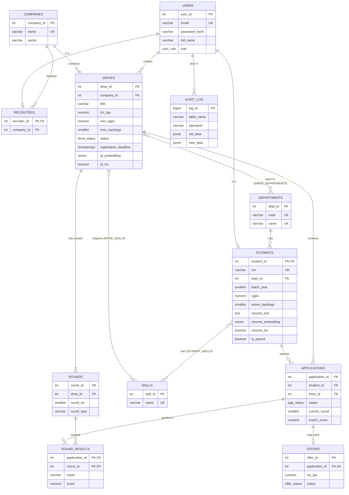

**Key design decisions**
- **Specialisation (ISA)**: `students` and `recruiters` are 1:1 sub-types of `users` and share its primary key (`student_id = user_id`), so authentication lives in one table while role-specific attributes stay in their own tables.
- **Weak entity**: a `round` exists only within a drive, identified by `(drive_id, round_no)` (UNIQUE), with ON DELETE CASCADE.
- **M:N relationships** (`student_skills`, `drive_skills`, `drive_departments`) are resolved with junction tables using composite primary keys.
- **Associative entity**: `applications` connects students and drives (UNIQUE `(student_id, drive_id)`) and carries its own state. `round_results` connects applications and rounds.
- **1:0..1**: an application has at most one `offer` (UNIQUE `application_id`).

## 5. Relational schema

Primary keys are **bold**. Foreign keys are marked with †.

- USERS(**user_id**, email, password_hash, full_name, role, is_active, created_at)
- DEPARTMENTS(**dept_id**, code, name)
- STUDENTS(**student_id**†→USERS, srn, dept_id†→DEPARTMENTS, batch_year, cgpa, active_backlogs, phone, linkedin_url, resume_text, resume_embedding, resume_tsv, is_placed, updated_at)
- SKILLS(**skill_id**, name)
- STUDENT_SKILLS(**student_id**†→STUDENTS, **skill_id**†→SKILLS, proficiency)
- COMPANIES(**company_id**, name, sector, website, about)
- RECRUITERS(**recruiter_id**†→USERS, company_id†→COMPANIES, designation)
- DRIVES(**drive_id**, company_id†→COMPANIES, created_by†→USERS, title, job_type, description, location, ctc_lpa, min_cgpa, max_backlogs, batch_year, status, registration_deadline, jd_embedding, jd_tsv, created_at)
- DRIVE_DEPARTMENTS(**drive_id**†→DRIVES, **dept_id**†→DEPARTMENTS)
- DRIVE_SKILLS(**drive_id**†→DRIVES, **skill_id**†→SKILLS)
- ROUNDS(**round_id**, drive_id†→DRIVES, round_no, name, round_type, scheduled_at); UNIQUE(drive_id, round_no)
- APPLICATIONS(**application_id**, student_id†→STUDENTS, drive_id†→DRIVES, status, current_round, match_score, applied_at, updated_at); UNIQUE(student_id, drive_id)
- ROUND_RESULTS(**application_id**†→APPLICATIONS, **round_id**†→ROUNDS, result, score, remarks, evaluated_by†→USERS, evaluated_at)
- OFFERS(**offer_id**, application_id†→APPLICATIONS (UNIQUE), ctc_lpa, status, offered_at, respond_by, responded_at)
- AUDIT_LOG(**log_id**, table_name, operation, row_pk, actor_id, old_data, new_data, logged_at)

**Normalisation.** The schema follows relational normalisation principles by representing multi-valued relationships, such as student skills and eligible departments, in separate tables rather than comma-separated lists. Derived information is calculated through `fn_drive_tier(ctc)` and reporting views where appropriate. Two values are intentionally stored for operational reasons: `match_score` preserves the similarity score calculated when an application is submitted, while `is_placed` is maintained by the offer-acceptance procedure to support efficient filtering. These design choices should be considered alongside the functional dependencies of individual relations when assessing formal normal forms.

## 6. Data dictionary

### users
| Column | Type | Constraints | Description |
|--------|------|-------------|-------------|
| user_id | SERIAL | PK | Surrogate key |
| email | VARCHAR(120) | NOT NULL, UNIQUE, CHECK format, CHECK lowercase | Login id |
| password_hash | VARCHAR(100) | NOT NULL | bcrypt hash (never the plain password) |
| full_name | VARCHAR(80) | NOT NULL, CHECK length ≥ 2 | |
| role | user_role ENUM | NOT NULL | admin / recruiter / student |
| is_active | BOOLEAN | DEFAULT TRUE | Disabled accounts can't log in |
| created_at | TIMESTAMPTZ | DEFAULT now() | |

### students
| Column | Type | Constraints | Description |
|--------|------|-------------|-------------|
| student_id | INT | PK, FK → users ON DELETE CASCADE | Same id as the user |
| srn | VARCHAR(13) | UNIQUE, CHECK `^PES[12]UG[0-9]{2}[A-Z]{2}[0-9]{3}$` | University SRN |
| dept_id | INT | FK → departments ON DELETE RESTRICT | |
| batch_year | SMALLINT | CHECK 2020–2035 | Graduating year |
| cgpa | NUMERIC(4,2) | CHECK 0–10 | Verified by admin |
| active_backlogs | SMALLINT | CHECK ≥ 0 | |
| phone | VARCHAR(10) | CHECK Indian mobile format | Optional |
| linkedin_url | VARCHAR(150) | CHECK linkedin.com URL | Added via ALTER TABLE |
| resume_text | TEXT | NOT NULL | Free text used for search |
| resume_embedding | vector(384) | HNSW index | Embedding of resume + skills |
| resume_tsv | tsvector | GENERATED ALWAYS … STORED, GIN index | Full-text vector |
| is_placed | BOOLEAN | DEFAULT FALSE | Set by `sp_accept_offer` |

### drives
| Column | Type | Constraints | Description |
|--------|------|-------------|-------------|
| drive_id | SERIAL | PK | |
| company_id | INT | FK → companies ON DELETE CASCADE | |
| created_by | INT | FK → users ON DELETE SET NULL | Recruiter who created it |
| title, description, location | VARCHAR / TEXT | NOT NULL | |
| job_type | VARCHAR(12) | CHECK IN ('FTE','Internship','Intern+FTE') | |
| ctc_lpa | NUMERIC(6,2) | CHECK 0 < ctc < 500 | Tier: Dream ≥ 20, Core ≥ 10, else Mass |
| min_cgpa / max_backlogs | NUMERIC / SMALLINT | CHECK ranges | Eligibility criteria |
| batch_year | SMALLINT | | Eligible graduating batch |
| status | drive_status ENUM | DEFAULT 'draft' | draft → open → closed → completed |
| registration_deadline | TIMESTAMPTZ | NOT NULL | |
| jd_embedding | vector(384) | HNSW index | Embedding of title + JD + skills |
| jd_tsv | tsvector | GENERATED (title weight A, description B), GIN | |

### applications
| Column | Type | Constraints | Description |
|--------|------|-------------|-------------|
| application_id | SERIAL | PK | |
| student_id | INT | FK → students (added by ALTER) | |
| drive_id | INT | FK → drives (added by ALTER) | |
| — | | UNIQUE (student_id, drive_id) | One application per drive |
| status | app_status ENUM | | applied / in_process / selected / rejected / withdrawn |
| current_round | SMALLINT | | Round the candidate is waiting on |
| match_score | NUMERIC(5,4) | CHECK −1…1 | Cosine similarity, stamped by trigger |

### Other tables
| Table | Purpose and key constraints |
|-------|-----------------------------|
| departments | `code` UNIQUE with CHECK `^[A-Z]{2,6}$`; `name` UNIQUE |
| skills | `name` UNIQUE |
| student_skills | PK (student_id, skill_id); proficiency CHECK 1–5 |
| companies | `name` UNIQUE; website CHECK `^https?://` |
| recruiters | PK = FK → users; company FK ON DELETE **RESTRICT** (a company with recruiters can't be deleted) |
| drive_departments / drive_skills | Composite PKs, CASCADE on drive delete. No rows in drive_departments means all departments are eligible. |
| rounds | UNIQUE (drive_id, round_no); round_type CHECK IN ('OA','GD','Technical','HR') |
| round_results | PK (application_id, round_id); result CHECK IN ('cleared','rejected'); score CHECK 0–100 |
| offers | `application_id` UNIQUE; CHECK respond_by > offered_at; CHECK pending ⇔ responded_at IS NULL |
| audit_log | JSONB before/after images, actor id, timestamp |

## 7. SQL implementation

All DDL is in [`db/`](../db) and is run in order by `npm run db:setup`.

### 7.1 DDL (CREATE / ALTER / DROP)
- `DROP VIEW / TABLE / TYPE IF EXISTS … CASCADE` makes the script re-runnable.
- `CREATE TYPE … AS ENUM` for roles and statuses (domain integrity).
- `CREATE TABLE` with inline PK, UNIQUE, CHECK, DEFAULT, generated columns and FKs with chosen referential actions (CASCADE / RESTRICT / SET NULL).
- `ALTER TABLE … ADD CONSTRAINT … FOREIGN KEY` for the students and applications FKs, and `ALTER TABLE students ADD COLUMN linkedin_url` plus a new CHECK.

### 7.2 Indexes (`02_indexes.sql`)
| Index | Type | Used by |
|-------|------|---------|
| idx_applications_drive (drive_id, status) | B-tree composite | Drive funnel, applicant list |
| idx_applications_student (student_id, status) | B-tree composite | Student dashboard |
| idx_drives_open_deadline WHERE status = 'open' | **Partial** B-tree | Browse open drives |
| idx_students_batch_cgpa (batch_year, cgpa DESC) | B-tree composite | Eligibility filtering |
| idx_drives_jd_tsv, idx_students_resume_tsv | **GIN** | Full-text search |
| idx_students_resume_vec, idx_drives_jd_vec | **HNSW** (vector_cosine_ops) | k-NN similarity search |

### 7.3 Functions and stored procedures (`03_functions_triggers.sql`)
| Name | Kind | What it does |
|------|------|--------------|
| `fn_drive_tier(ctc)` | SQL function (IMMUTABLE) | Dream / Core / Mass classification |
| `fn_match_score(student, drive)` | SQL function | `1 − (resume_embedding <=> jd_embedding)` |
| `fn_check_eligibility(student, drive)` | PL/pgSQL set-returning function | Returns (eligible, reason): drive open, deadline, batch, department, CGPA, backlogs, placement policy, duplicate. Used by the UI **and** enforced by a trigger. |
| `sp_record_round_result(app, result, score, remarks, evaluator)` | **Procedure** | Locks the application (`SELECT … FOR UPDATE`), inserts the round result, then rejects, advances to the next round, or selects the candidate and inserts the offer. |
| `sp_accept_offer(offer, student, INOUT withdrawn)` | **Procedure** | Locks the offer, validates owner, status and deadline, accepts it, marks the student placed, auto-declines other pending offers, and withdraws applications the policy no longer allows. Returns the number withdrawn. |

### 7.4 Triggers
| Trigger | Timing | Purpose |
|---------|--------|---------|
| trg_application_eligibility | BEFORE INSERT on applications | Calls `fn_check_eligibility` and raises an exception with the reason if not eligible. Initialises status and round, and stamps `match_score`. |
| trg_application_status_guard | BEFORE UPDATE on applications | Final states (selected / rejected / withdrawn) can't change. Maintains updated_at. |
| trg_offer_requires_selection | BEFORE INSERT on offers | Offers only for selected applications |
| trg_student_resume_changed | BEFORE UPDATE on students | Clears a stale embedding when resume text changes without a new vector |
| trg_drive_status_guard | BEFORE UPDATE OF status on drives | A completed drive can't be reopened |
| trg_audit_applications / offers / drives (`05_audit.sql`) | AFTER INSERT/UPDATE/DELETE | Generic `trg_fn_audit()` writes JSONB old/new rows and the acting user, read from the transaction-local setting `app.user_id` set by the API |

### 7.5 Views (`04_views.sql`)
| View | Technique |
|------|-----------|
| v_drive_summary | LEFT JOIN + GROUP BY + `COUNT(*) FILTER (WHERE …)` funnel per drive |
| v_dept_placement_stats | LEFT JOIN LATERAL (best accepted offer per student), placement % per department and batch |
| v_company_offer_stats | Multi-join + GROUP BY + HAVING COUNT ≥ 1 |
| v_student_overview | Scalar subqueries + `string_agg` for skills and counters |

### 7.6 Transactions
Every multi-statement write goes through `withTransaction()` in `src/lib/db.ts`: `BEGIN`, `set_config('app.user_id', …, true)`, the work, then `COMMIT`, or `ROLLBACK` on any error. Examples:
- **Register**: insert into `users` and `students` together. If the SRN is invalid, the user row is rolled back too.
- **Create drive**: drive, departments, skills and rounds are all inserted together, or none are.
- **Add company**: if the company insert succeeds but the recruiter email is a duplicate, the company is rolled back as well.
- **Accept offer / record result**: the procedures use row-level locks (`FOR UPDATE`) so two concurrent requests can't double-accept or double-grade.

## 8. Vector database / semantic search

| Question | Answer |
|----------|--------|
| What is embedded? | **Students:** resume text + skill names. **Drives:** title + job description + required skill names. |
| Model | `sentence-transformers/all-MiniLM-L6-v2` (ONNX, quantised), run locally in Node.js via `@huggingface/transformers`. Output is 384 dimensions with mean pooling and L2 normalisation. No external API is needed. |
| Storage | `vector(384)` columns `students.resume_embedding` and `drives.jd_embedding` (pgvector), each with an **HNSW** index using `vector_cosine_ops`. |
| Similarity metric | **Cosine distance** (`<=>`). Similarity = 1 − distance, shown as a match %. |
| When computed | When the student saves their profile, when a recruiter creates a drive, and in the seed script. The vector is written in the same transaction as the text, and a trigger nulls stale vectors. |
| Retrieval | `ORDER BY embedding <=> query_vector LIMIT k` (k-NN), combined in the same SQL with relational filters (eligibility function, drive status, department, CGPA). |

Where it is used:
1. **Recommended drives** (student dashboard): nearest open drives to the student's resume vector, filtered by `fn_check_eligibility`.
2. **Applicant ranking** (recruiter drive page): applicants ordered by `match_score`, which the insert trigger computes.
3. **Suggested candidates**: eligible students who haven't applied, nearest to the JD vector.
4. **Talent search / semantic drive search**: the user's free-text query is embedded at request time and compared with the stored vectors. It's shown side by side with PostgreSQL full-text search (`tsvector @@ websearch_to_tsquery`, ranked by `ts_rank`) to show the difference. Keyword search needs the exact words, while semantic search finds paraphrases.

## 9. Important queries

All of these run live on the admin **SQL Lab** page (see `src/lib/showcase.ts`).

**Recommended drives for a student (vector + function + join)**
```sql
SELECT d.drive_id, d.title, c.name AS company, d.ctc_lpa,
       ROUND((1 - (d.jd_embedding <=> s.resume_embedding))::numeric, 4) AS score
FROM students s
JOIN drives d    ON d.status = 'open' AND d.jd_embedding IS NOT NULL
JOIN companies c ON c.company_id = d.company_id
WHERE s.student_id = $1
  AND (SELECT eligible FROM fn_check_eligibility(s.student_id, d.drive_id))
ORDER BY d.jd_embedding <=> s.resume_embedding
LIMIT 5;
```

**Drives with at least 3 applicants (GROUP BY + HAVING)**
```sql
SELECT c.name, d.title, COUNT(*) AS applicants, ROUND(AVG(a.match_score), 3) AS avg_match
FROM applications a JOIN drives d ON d.drive_id = a.drive_id JOIN companies c ON c.company_id = d.company_id
GROUP BY c.name, d.title HAVING COUNT(*) >= 3 ORDER BY avg_match DESC;
```

**Students above their department's average CGPA (correlated subquery)**
```sql
SELECT u.full_name, s.cgpa FROM students s JOIN users u ON u.user_id = s.student_id
WHERE s.cgpa > (SELECT AVG(s2.cgpa) FROM students s2 WHERE s2.dept_id = s.dept_id);
```

**Top 3 applicants per drive (window function)**
```sql
WITH ranked AS (
  SELECT a.drive_id, a.student_id, a.match_score,
         RANK() OVER (PARTITION BY a.drive_id ORDER BY a.match_score DESC) AS rnk
  FROM applications a)
SELECT * FROM ranked WHERE rnk <= 3;
```

**Unplaced students who never applied (NOT EXISTS)**, **skills students have that no drive asks for (EXCEPT)**, **round-wise pass percentage (CTE + FILTER)**, **full-text search with ts_rank**, **top-3 nearest students per open drive (LATERAL + `<=>`)** and **EXPLAIN showing the HNSW index** are in the SQL Lab as well.

**DML used by the application**
- INSERT: register, apply, create drive/rounds, add company, round results, offers (via procedure)
- UPDATE: profile and resume, withdraw, decline/accept offer, drive status, CGPA verification
- DELETE: replace student skills, delete company (CASCADE to drives; RESTRICT when recruiters exist)
- SELECT: every page, using joins, aggregates, subqueries and views

## 10. System architecture

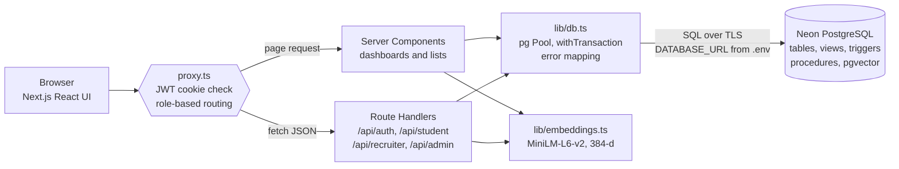

- **Presentation**: Next.js App Router pages per role (`/student`, `/recruiter`, `/admin`).
- **Security**: `src/proxy.ts` checks the signed JWT cookie on every request and redirects or returns 401/403 by role. Every API handler re-checks the role (`requireApi`). Passwords are hashed with bcrypt, and SQL always uses parameterised queries (`$1, $2 …`), so there is no SQL injection.
- **Data access**: one `pg` connection pool configured only from `DATABASE_URL`. Business rules live in the database (constraints, triggers, procedures), so they apply no matter which client writes.

## 11. Application screenshots

**1. Login page with role-based demo accounts**

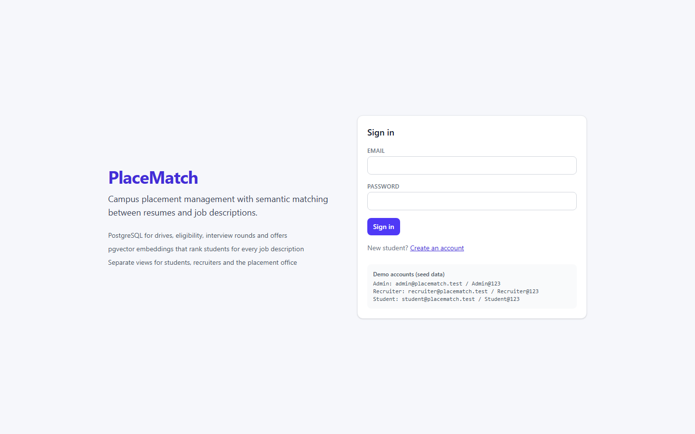

**2. Student dashboard: pending offer, round-by-round application status, and recommended drives from vector search**

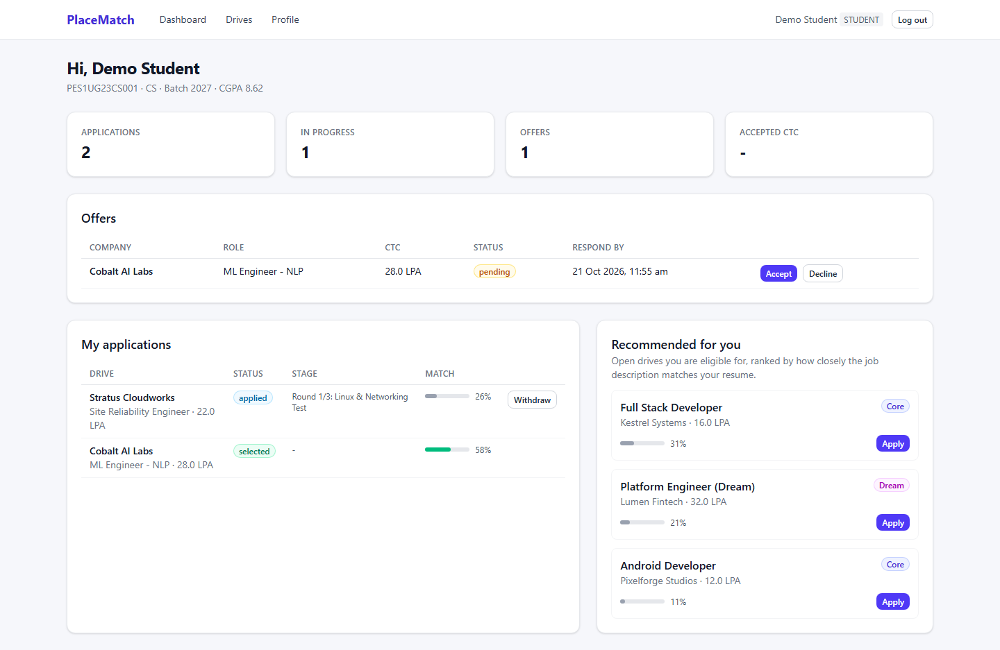

**3. Semantic drive search with per-drive eligibility reasons from `fn_check_eligibility`**


**4. Student profile: saving the resume recomputes its embedding**

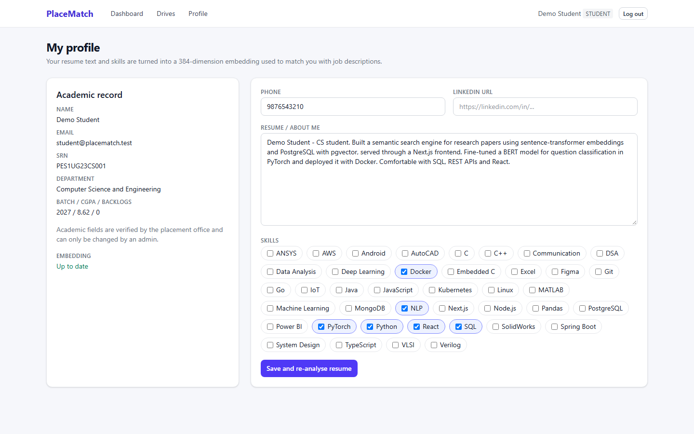

**5. Recruiter home: company drives with funnel counts from `v_drive_summary`**


**6. Drive detail: round funnel, applicants ranked by match score with round-result entry, and suggested non-applicants**

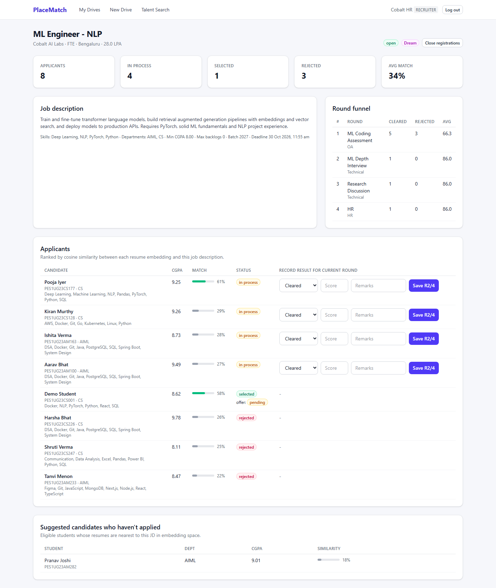

**7. Creating a drive with eligibility, departments, skills and rounds (one transaction)**

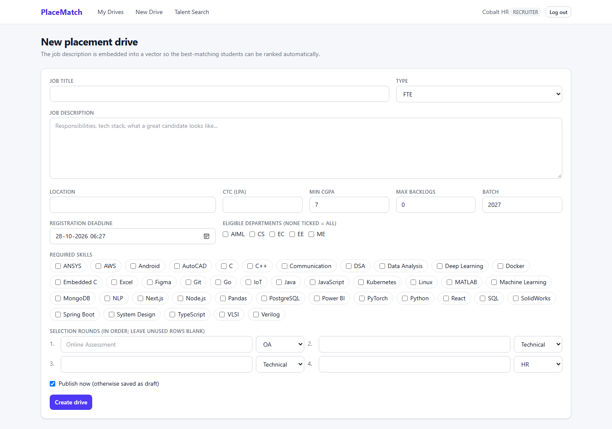

**8. Talent search: semantic (pgvector) results versus keyword (full-text) results for the same query**

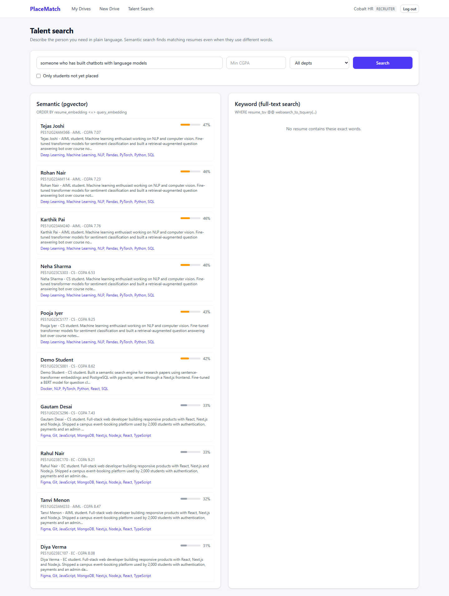

**9. Placement office dashboard built from views and GROUP BY / HAVING queries**

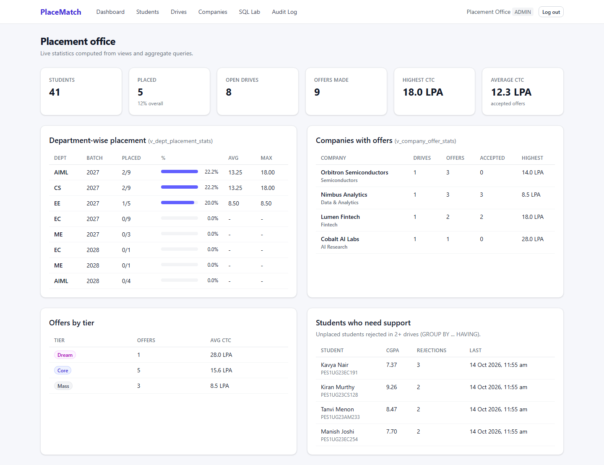

**10. Student list (`v_student_overview`) with CGPA and backlog verification**


**11. All drives with status management**

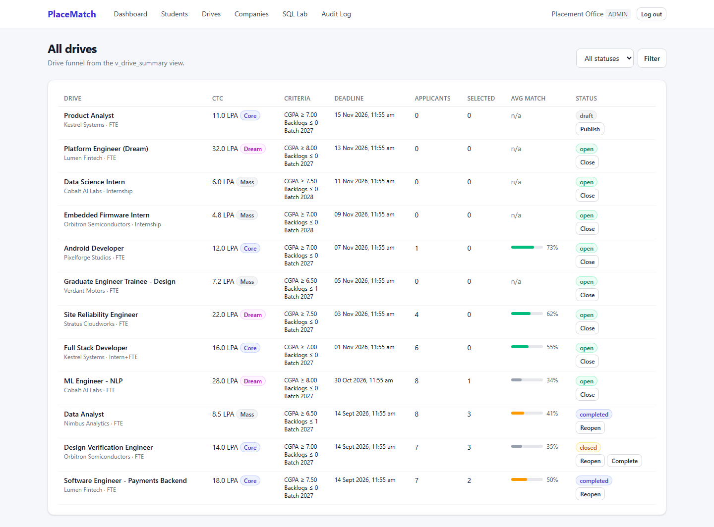

**12. SQL Lab: top-3 nearest students per open drive (LATERAL + `<=>`)**


**13. SQL Lab: window function ranking**

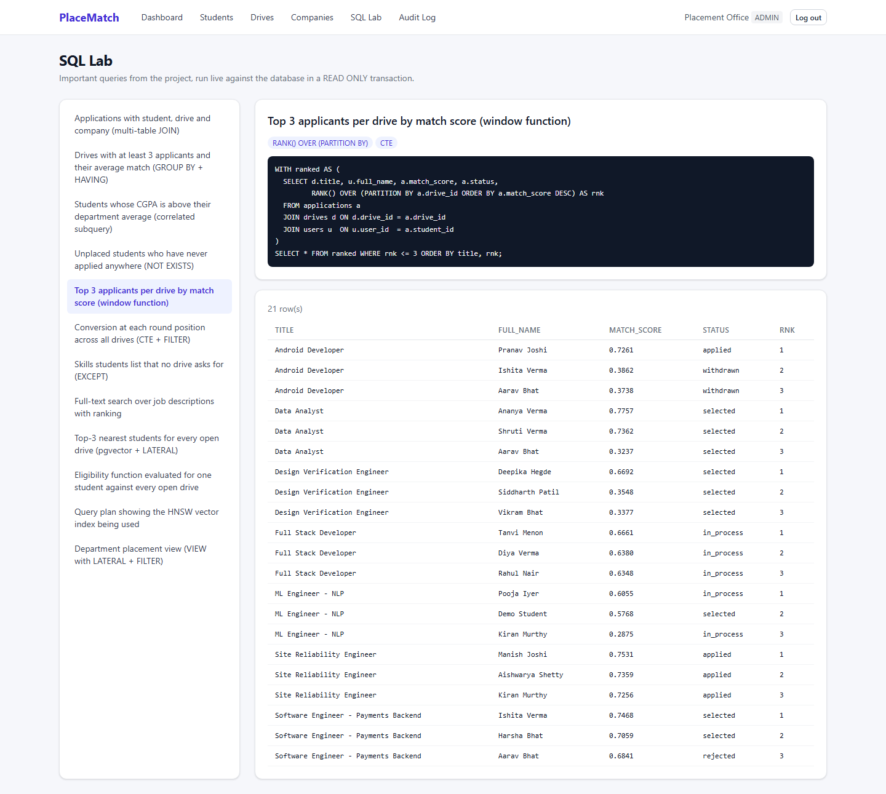

**14. Audit log written by triggers, showing field-level changes and the acting user**

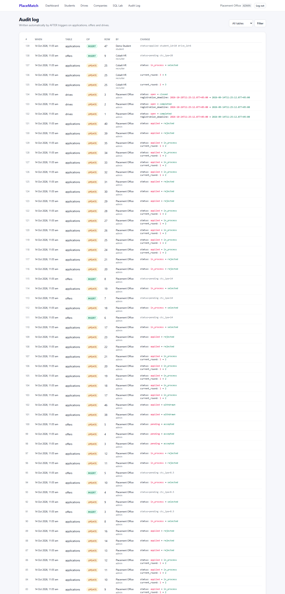

## 12. Testing

`npm run test:db` runs automated database test cases covering constraints, triggers, procedures, transactions, views, full-text and vector search. Each test runs inside `BEGIN … ROLLBACK`, so it leaves no trace. The results are in [`test-results.md`](test-results.md).

**Result: 26 / 26 passed.**

| # | Area | Test case | Result | Observed |
|---|------|-----------|--------|----------|
| 1 | Constraint | CHECK: malformed SRN is rejected | PASS | new row for relation "students" violates check constraint "chk_srn" |
| 2 | Constraint | CHECK: CGPA above 10 is rejected | PASS | new row for relation "students" violates check constraint "chk_cgpa" |
| 3 | Constraint | CHECK: invalid email format is rejected | PASS | new row for relation "users" violates check constraint "chk_email_format" |
| 4 | Constraint | UNIQUE: duplicate email is rejected | PASS | duplicate key value violates unique constraint "users_email_key" |
| 5 | Constraint | FOREIGN KEY: student in a non-existent department is rejected | PASS | insert or update on table "students" violates foreign key constraint "fk_students_dept" |
| 6 | Constraint | ENUM: unknown application status is rejected | PASS | invalid input value for enum app_status: "hired" |
| 7 | Trigger | TRIGGER: eligible student can apply; match score is stamped automatically | PASS | match_score = 1.0000 |
| 8 | Trigger | TRIGGER: CGPA below drive minimum is blocked | PASS | Not eligible: Minimum CGPA is 8.00 (yours: 6.10) |
| 9 | Trigger | TRIGGER: department not in the drive list is blocked | PASS | Not eligible: Your department is not eligible |
| 10 | Trigger | TRIGGER: applying to a draft drive is blocked | PASS | Not eligible: Drive is not open for registration |
| 11 | Trigger | TRIGGER: duplicate application is blocked | PASS | Not eligible: You have already applied to this drive |
| 12 | Procedure | PROCEDURE: clearing round 1 of 2 advances the candidate | PASS | status=in_process, current_round=2 |
| 13 | Procedure | PROCEDURE: clearing the last round selects the candidate and creates an offer | PASS | offer 14.00 LPA, pending |
| 14 | Procedure | PROCEDURE: rejection ends the application; grading it again fails | PASS | Application is already rejected |
| 15 | Trigger | TRIGGER: an offer cannot be inserted for a non-selected application | PASS | Offers can only be made to selected candidates |
| 16 | Transaction | TRANSACTION: accepting an offer places the student, declines other offers, withdraws non-dream applications | PASS | withdrawn=1; offer2=declined; dream app kept |
| 17 | Trigger | POLICY: a placed student cannot apply to a non-Dream drive | PASS | Not eligible: Already placed at 12.00 LPA: only Dream drives paying >= 18.00 LPA allowed |
| 18 | Transaction | TRANSACTION: failure inside a transaction rolls back earlier statements | PASS | company insert undone after duplicate recruiter email |
| 19 | Trigger | TRIGGER: final application states cannot change | PASS | Cannot change an application that is already withdrawn |
| 20 | Trigger | TRIGGER: a completed drive cannot be reopened | PASS | A completed drive cannot be reopened |
| 21 | Trigger | TRIGGER: editing resume text clears the stale embedding | PASS | resume_embedding set to NULL |
| 22 | Trigger | AUDIT: updates are logged with the acting user (app.user_id) | PASS | logged applied -> withdrawn by user 84 |
| 23 | Vector | VECTOR: nearest-neighbour search ranks the most similar resume first | PASS | exact match ranked #1 with similarity 1.0 |
| 24 | Vector | VECTOR: real resume embeddings rank a relevant student above an unrelated one | PASS | 5/5 nearest resumes to the NLP job are ML profiles |
| 25 | Search | FULL-TEXT: keyword search finds matching job descriptions | PASS | Site Reliability Engineer, Platform Engineer (Dream) |
| 26 | View | VIEW: v_drive_summary counts match the base tables | PASS | 40 = 40 |

The API layer was also tested end to end through the running app. Students were blocked from recruiter APIs with 403. Recruiters couldn't grade another company's applications. Duplicate and ineligible applications returned the trigger's message to the UI. CHECK violations (for example a phone number or CTC) came back as readable errors. The full apply → grade → offer → accept flow updated every table consistently.

## 13. Individual contributions

| Area | Swaroop Venkateshwar | Shreesh S A |
|------|----------------------|-------------|
| Database | ER design and schema (`01_schema.sql`), indexes, eligibility function, `sp_record_round_result` / `sp_accept_offer`, triggers | Reporting views (`04_views.sql`), audit trigger and audit log, analytical queries for the SQL Lab |
| Vector / search | Embedding pipeline (MiniLM, pgvector, HNSW), recommendations, applicant ranking | Full-text search (tsvector + GIN), semantic vs keyword talent search |
| Application | Student module (dashboard, drive search, profile, offers), DB access layer and transactions | Authentication and role-based access, recruiter module, admin module (dashboard, students, companies, drives, SQL Lab) |
| Documentation / testing | Database test suite, seed data | Project report, README, screenshots |

## 14. Conclusion

PlaceMatch shows how a relational database can be the core of a real application rather than just storage. Placement rules (eligibility, round progression, offer acceptance and the Dream policy) are encoded in constraints, triggers and stored procedures, so they hold for every client and every concurrent request. Views and aggregate queries give the placement office live statistics without duplicated data. pgvector adds semantic understanding of resumes and job descriptions in the same database, so similarity search combines naturally with relational filters in a single SQL statement, inside the same transactions.

**Possible extensions**: a hybrid score that blends `ts_rank` with vector similarity, scheduled reminders for offer deadlines, resume PDF upload with text extraction, and row-level security policies per role inside PostgreSQL.
